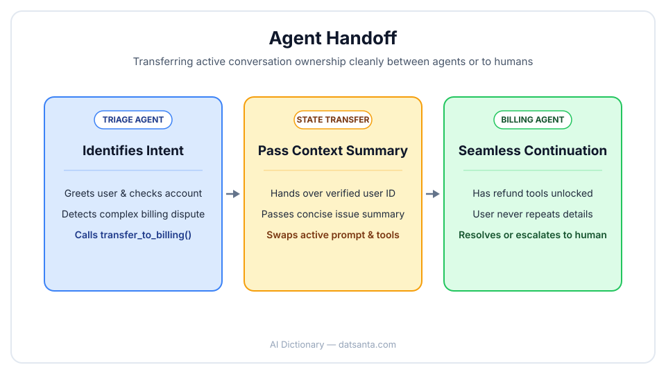

# Agent Handoff

An **agent handoff** is transferring control of an active conversation or task from one specialized agent to another—or to a human—while passing along the relevant state and context summary.

## Everyday example

When you call your bank about a stolen card, the front-desk receptionist verifies your identity and then transfers you to the fraud specialist with your verified profile already on screen so you do not start over. In code, a triage agent returns a structured handoff tool call (`transfer_to_billing_agent`) that swaps the active system prompt and toolset cleanly.

## Don't confuse with

- **[Function Calling](function-calling.md):** A normal tool call fetches data or runs an action and returns control to the *same* agent; a handoff transfers ongoing conversation ownership to a *different* agent.

## Related terms

- [Multi-Agent System](multi-agent-system.md)
- [Escalation Path](escalation-path.md)
- [State Machine](state-machine.md)
