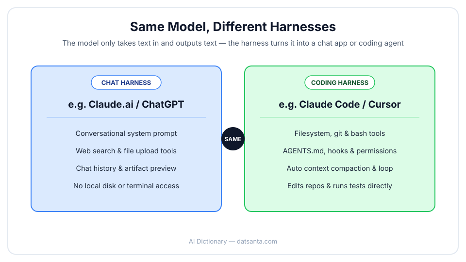

# Harness (Agent Harness)

A **harness** is the complete software wrapper around an LLM—system prompts, tools, context-window management, permission checks, hooks, and the execution loop—that turns a plain text-in/text-out model into a working AI product or coding agent.

## Everyday example

Think of an LLM as a powerful car engine sitting on a garage stand: by itself it only spins a shaft (text in, text out). The harness is the chassis, steering wheel, brakes, fuel tank, and dashboard built around that engine. Putting the exact same model inside a chat harness like Claude.ai lets you answer questions, while putting it inside a coding harness like Claude Code, Cursor, or Codex CLI gives it file-editing tools, shell access, permission prompts, and automatic context compaction. When two AI tools behave differently on the same model, the harness is usually the reason.

## Don't confuse with

- **[LLM](llm.md):** The LLM is the underlying neural network predicting tokens; the harness is the surrounding software that runs the agent loop, executes tool calls, and enforces rules like `AGENTS.md`.
- **[Orchestration](orchestration.md):** Orchestration coordinates multiple models, agents, or pipeline steps together; a harness is the runtime shell wrapping a model with tools, state, and permissions so it can act.

## Related terms

- [AI Agent](ai-agent.md)
- [Function Calling](function-calling.md)
- [System Prompt](system-prompt.md)
