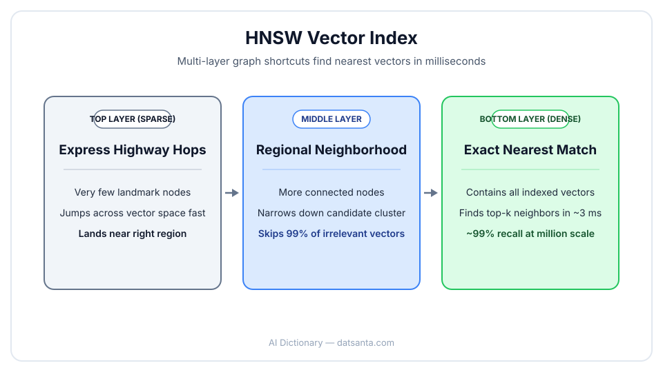

# HNSW (Hierarchical Navigable Small World)

**HNSW** is the most widely used graph-based index in vector databases that finds nearest-neighbor embeddings in milliseconds without comparing a query against every single vector in storage.

## Everyday example

Think of flying across a country: first you take express highways between major hub cities (top sparse layer), then regional roads into a neighborhood (middle layer), and finally local streets to the exact house (bottom dense layer). HNSW builds that multi-layer shortcut graph for vectors, delivering ~99% recall across millions of embeddings in just a few milliseconds.

## Don't confuse with

- **[Cosine Similarity](cosine-similarity.md):** Cosine similarity is the math formula measuring distance between two vectors; HNSW is the fast graph index structure that decides *which* vectors to compare.

## Related terms

- [Vector Database](vector-database.md)
- [Embeddings](embeddings.md)
- [Cosine Similarity](cosine-similarity.md)
