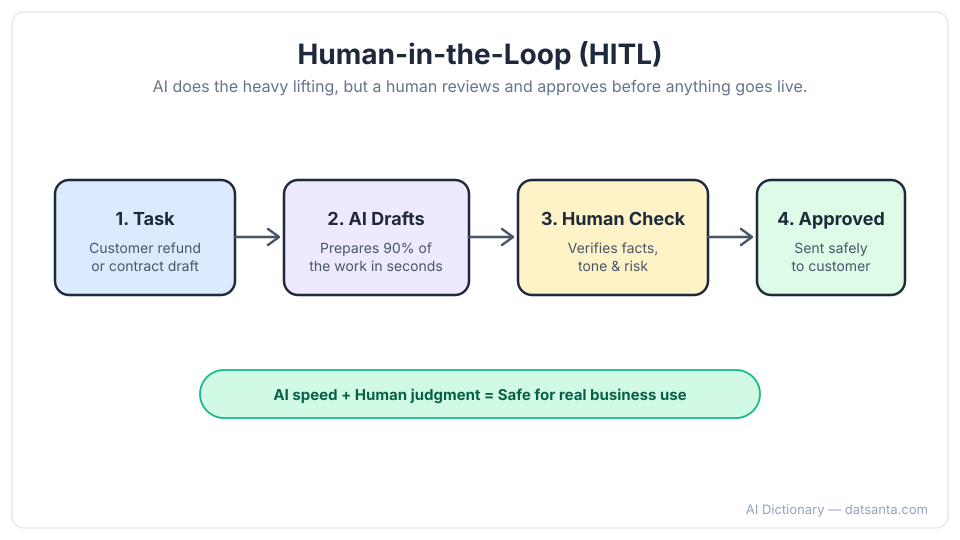

# Human-in-the-Loop (HITL)

**Human-in-the-loop** means keeping a person in charge of reviewing, editing, or approving AI output before it reaches a customer or triggers a real action. AI drafts; humans decide.

## Everyday example

Think of an airline autopilot. It handles steady cruising for hours, but trained pilots stay in the cockpit to monitor instruments, handle bad weather, and make final landing calls.

In business, an AI can draft 50 customer refund replies or summarize a contract in seconds, while a team member spends 10 seconds checking facts and clicking send. You get AI speed without risking public mistakes.

## Don't confuse with

- **Full automation:** Removing humans completely so AI acts on its own — risky when mistakes affect money, legal compliance, or customer trust.
- **Manual work:** Doing everything from scratch; with human-in-the-loop, AI does 80–90% of the first draft so staff only focus on judgment calls.

## Related terms

- [Hallucination](hallucination.md)
- [Guardrails](guardrails.md)
- [AI Governance](ai-governance.md)
