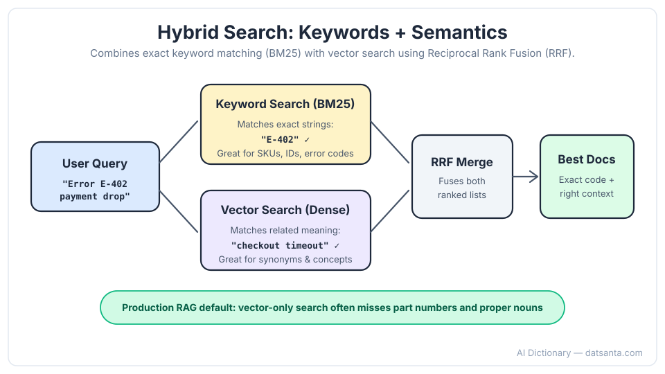

# Hybrid Search

**Hybrid search** runs exact keyword search (`BM25`) and semantic [vector search](vector-database.md) in parallel, then merges both ranked lists (typically via `Reciprocal Rank Fusion`) so neither exact codes nor synonyms get missed.

## Everyday example

Suppose a user searches your docs for `"Error E-402 payment drop"`. Vector search understands `"payment drop"` means `"checkout timeout"`, yet might rank a wrong page because `"E-402"` is an arbitrary code. Keyword search (`BM25`) nails `"E-402"` instantly.

Combining both ranked lists with `RRF` pushes the document containing both `"E-402"` and timeout troubleshooting straight to `#1`.

## Don't confuse with

- **Pure vector search:** Vector-only retrieval struggles with SKU numbers, user IDs, rare acronyms, and exact function names.
- **[Reranking](reranking.md):** Hybrid search *retrieves* candidates quickly from two indexes; reranking happens right afterward to score the top shortlist deeply.

## Related terms

- [Vector Database](vector-database.md)
- [Reranking](reranking.md)
- [RAG](rag.md)
- [Embeddings](embeddings.md)
