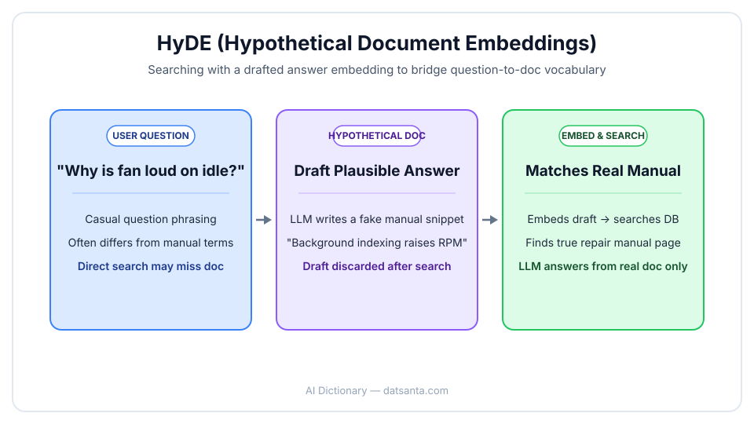

# HyDE (Hypothetical Document Embeddings)

**HyDE (Hypothetical Document Embeddings)** improves vector search by asking an LLM to draft a fake ideal answer to the user's question first, then embedding that *hypothetical answer* to search your knowledge base.

## Everyday example

Questions and answers often use different vocabulary: a user asks `"Why does my laptop fan spin loud when idle?"`, whereas the repair manual says `"Background indexing processes cause elevated thermal fan RPM"`. Embedding a short question may miss the technical doc, whereas embedding a plausible draft answer matches the manual's phrasing closely—boosting retrieval recall without touching the underlying index.

## Don't confuse with

- **[Query Rewriting](query-rewriting.md):** Query rewriting clarifies or splits the user's *question*; HyDE hallucinates a *template answer* purely to match document-style embeddings (the draft itself is thrown away afterward).

## Related terms

- [Query Rewriting](query-rewriting.md)
- [Embeddings](embeddings.md)
- [RAG](rag.md)
