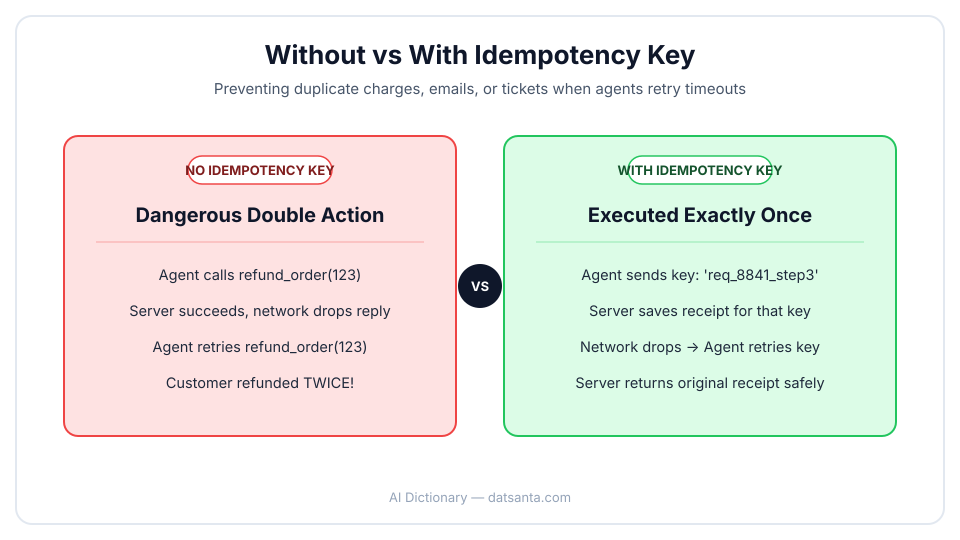

# Idempotency (in Tool Calls)

**Idempotency** ensures that if an AI agent retries a tool call—such as charging a card, sending an email, or creating a ticket—multiple times due to network timeouts, the side effect only happens **once**.

## Everyday example

Pressing an elevator's `"Call"` button five times does not summon five elevators; the button is idempotent. In agent systems, if a `refund_order(order_id=123)` API call succeeds on the server yet the response packet drops, an agent will naturally retry. Passing an `idempotency_key` lets the backend recognize the repeat and return the original receipt instead of double-refunding the customer.

## Don't confuse with

- **[Checkpointing](checkpointing.md):** Checkpointing saves where the agent workflow is in its graph; idempotency guarantees that external tool APIs remain safe if a step is re-executed.

## Related terms

- [Function Calling](function-calling.md)
- [Checkpointing](checkpointing.md)
- [Circuit Breaker](circuit-breaker.md)
