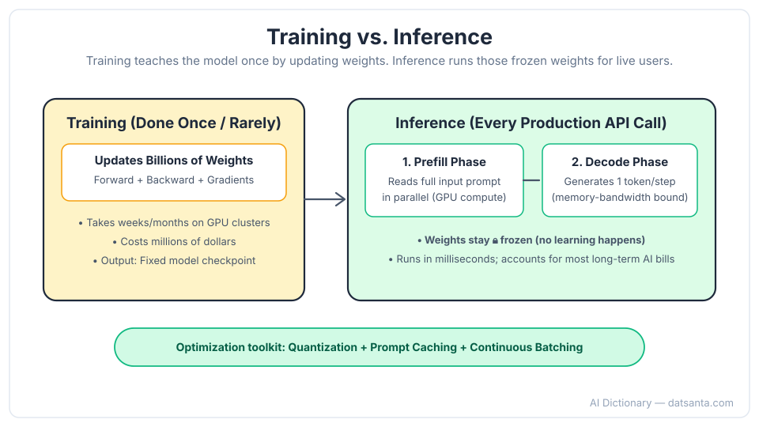

# Inference

**Inference** is running an already-trained AI model in production to generate predictions or replies from new inputs, while all model weights stay completely frozen.

## Everyday example

Training is studying for four years at university — expensive, slow, and done rarely. Inference is showing up to work every day and answering questions using what you already learned.

During LLM inference, each request runs in two phases: **Prefill** (reading your entire prompt in parallel, heavy on GPU compute) and **Decode** (generating one output [token](token.md) per step, limited by GPU memory bandwidth).

## Don't confuse with

- **Training / [Fine-tuning](fine-tuning.md):** Training modifies model weights via backpropagation; inference performs forward passes only and never learns permanently from your prompts.
- **One-time cost:** Training happens once, whereas inference runs on every single user API call — making inference optimization ([quantization](quantization.md), [prompt caching](prompt-caching.md)) key to controlling cloud bills.

## Related terms

- [Latency vs. Throughput](latency-vs-throughput.md)
- [Quantization](quantization.md)
- [Prompt Caching](prompt-caching.md)
- [Streaming](streaming.md)
