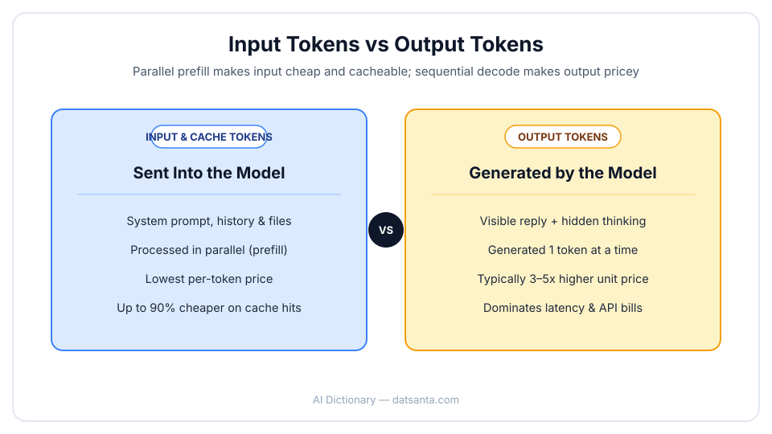

# Input vs. Output Tokens

**Input tokens** are everything sent *into* the model (system prompt, history, files, tool outputs), while **output tokens** are everything the model *generates* back (visible reply plus hidden reasoning tokens)—and output tokens typically cost 3–5x more.

## Everyday example

Reading a 10-page contract (input tokens) happens all at once in parallel during [prefill](prefill-and-decode.md), so it is fast and cheap—and repeated prefixes can be discounted up to 90% via [prompt caching](prompt-caching.md) (cache tokens). Writing a 10-page response (output tokens) happens sequentially one token at a time during decode, tying up GPU memory bandwidth and driving the biggest share of your API bill.

## Don't confuse with

- **[Context Window](context-window.md):** Context window is the total combined room for input + output tokens in one request; input vs. output tokens determines *billing rates* and *latency behavior*.

## Related terms

- [Token](token.md)
- [Prompt Caching](prompt-caching.md)
- [Prefill and Decode](prefill-and-decode.md)
