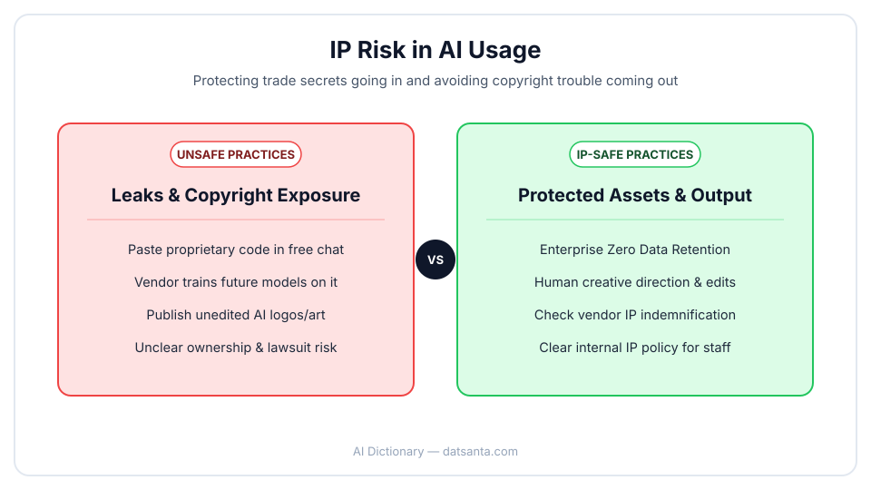

# IP Risk (Intellectual Property Risk)

**IP risk** is the legal and business danger of accidentally leaking company trade secrets to an AI vendor, or publishing AI-generated content that copies someone else's copyrighted work—or cannot be copyrighted yourself.

## Everyday example

Suppose a designer uses an unapproved image generator for a new beverage logo, and it outputs graphics nearly identical to a famous soda brand's trademark. Or an engineer pastes proprietary source code into a free chatbot that trains on user inputs. Both create IP risk: you could face copyright lawsuits, or lose exclusive ownership over your own inventions.

## Don't confuse with

- **[PII](pii.md):** PII risk is about exposing private personal details of individuals; IP risk is about protecting creative works, brands, code, and trade secrets.

## Related terms

- [Zero Data Retention](zero-data-retention.md)
- [Enterprise Agreement](enterprise-agreement.md)
- [Compliance](compliance.md)
