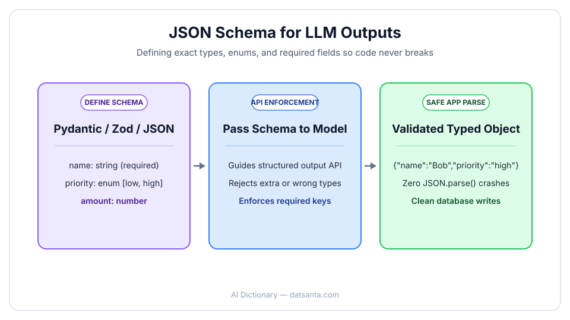

# JSON Schema

A **JSON Schema** is a formal contract describing the exact field names, data types, enums, and required properties an LLM's structured output must match so downstream application code can parse it safely.

## Everyday example

Think of an airport customs form with strict boxes: `full_name` must be text, `bag_count` must be an integer, and `purpose` must be one of `["business", "tourism"]`. Passing a JSON Schema (such as one generated from Pydantic or Zod) to an LLM API forces the response into that exact shape—eliminating missing keys, string-instead-of-number bugs, and brittle regex parsing.

## Don't confuse with

- **[Structured Outputs](structured-outputs.md):** Structured outputs is the *feature* of getting machine-readable data back from an LLM; JSON Schema is the *blueprint language* used to define that structure.

## Related terms

- [Structured Outputs](structured-outputs.md)
- [Grammar-Constrained Decoding](grammar-constrained-decoding.md)
- [Function Calling](function-calling.md)
