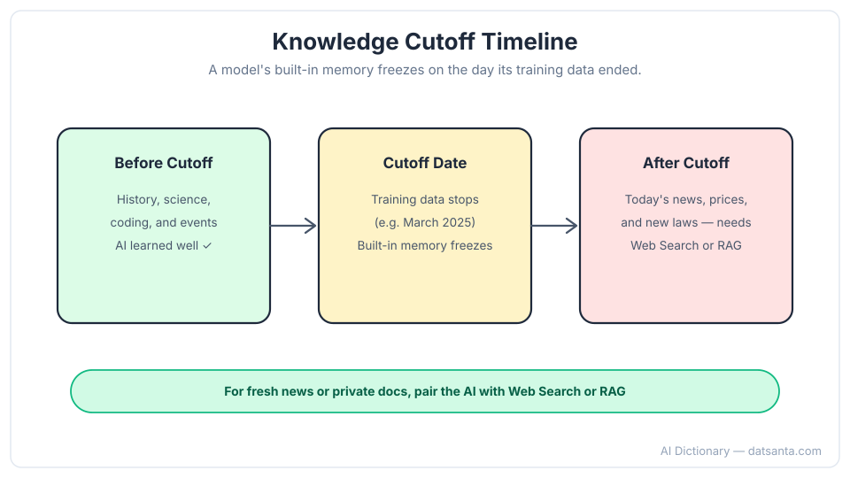

# Knowledge Cutoff

A **knowledge cutoff** is the specific date when an AI model's [training data](training-data.md) stopped. The model has zero built-in memory of news, laws, or events that happened after that date unless it searches the web.

## Everyday example

Think of a printed encyclopedia published in March 2025. It knows centuries of history up to that month, yet cannot tell you who won a match last weekend or today's exchange rate.

If you ask an offline [LLM](llm.md) about events after its cutoff, it may say *"I don't know"* — or worse, guess and [hallucinate](hallucination.md). Connecting the AI to live web search or [RAG](rag.md) bridges this gap.

## Don't confuse with

- **[Context window](context-window.md):** Context window is how much text the AI can read *in the current chat*; knowledge cutoff is *how recent* its built-in training memory is.
- **Live internet access:** Many modern chat apps add a web-search tool on top of the model, which lets them look up fresh news even though the underlying model still has a cutoff date.

## Related terms

- [Training Data](training-data.md)
- [Hallucination](hallucination.md)
- [RAG](rag.md)
- [LLM](llm.md)
