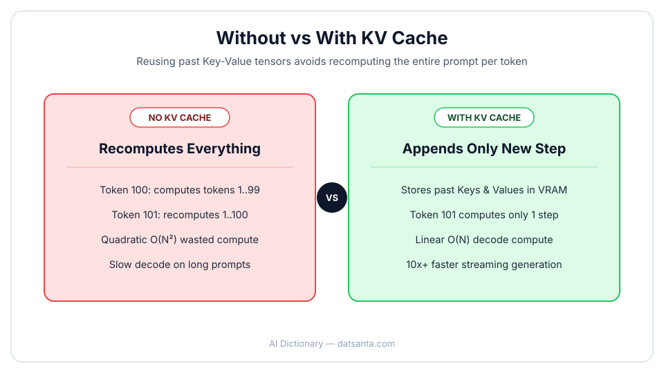

# KV Cache (Key-Value Cache)

A **KV cache** stores the intermediate attention keys and values of already-processed tokens in GPU memory so the model does not recompute the entire prompt for every single new token it generates.

## Everyday example

Imagine reading a 200-page novel and writing a summary note at the end of each chapter. When you start chapter 11, you do not re-read chapters 1 through 10 from word one—you glance at your saved notes and keep going. Without a KV cache, generating a 500-token reply would force the GPU to recalculate the prompt 500 times; with it, each new token only computes one step and appends to the cache.

## Don't confuse with

- **[Prompt Caching](prompt-caching.md):** KV cache is the low-level GPU memory buffer during active generation; prompt caching is an API-level feature that saves and reuses KV states across separate requests.

## Related terms

- [Prefill and Decode](prefill-and-decode.md)
- [Attention Mechanism](attention-mechanism.md)
- [VRAM](vram.md)
