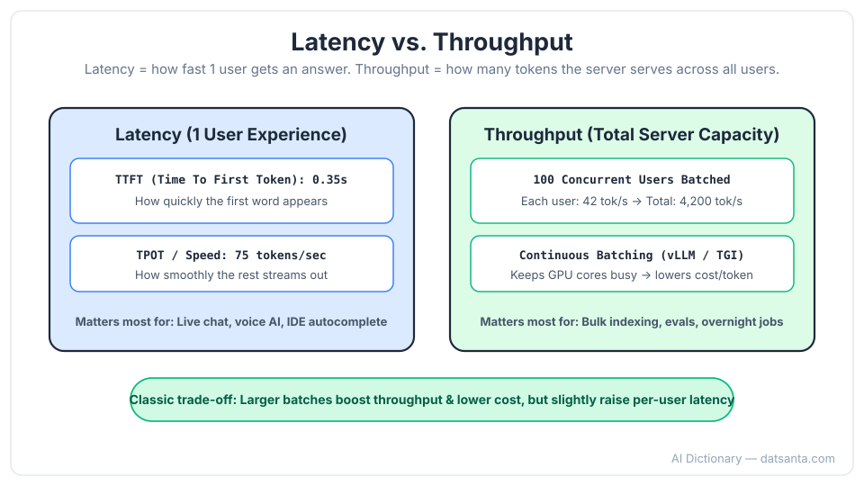

# Latency vs. Throughput

**Latency** measures how fast one user receives an answer (`TTFT` and tokens/sec), whereas **throughput** measures the total tokens per second a server processes across all concurrent users combined.

## Everyday example

Think of a ferry versus a speedboat. A speedboat has low **latency** — one passenger reaches the island in 3 minutes. A large ferry takes 10 minutes per trip (higher latency), yet carries 500 passengers at once — massive **throughput**.

In LLM serving, continuous batching (`vLLM`) groups 100 users together on one GPU, boosting total throughput to 4,200 tok/s and lowering cost per token while slightly slowing each individual stream.

## Don't confuse with

- **TTFT (Time To First Token):** Only the wait before the *first* streamed token appears; total latency includes generating every remaining token until completion.
- **Network ping:** API latency is dominated by GPU prefill/decode compute (`inference`), not just HTTP round-trip travel time.

## Related terms

- [Streaming](streaming.md)
- [Inference](inference.md)
- [Rate Limiting](rate-limiting.md)
- [Quantization](quantization.md)
