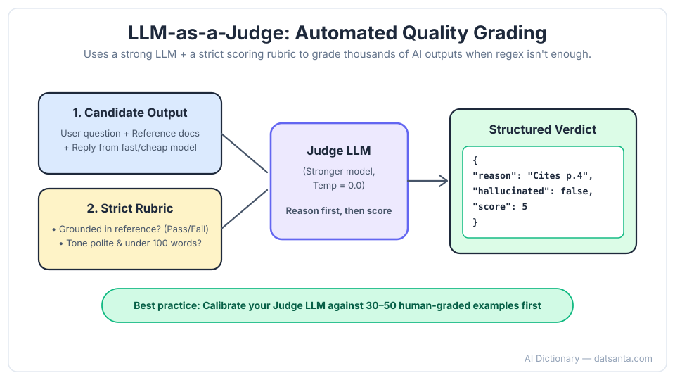

# LLM-as-a-Judge

**LLM-as-a-Judge** uses a strong, capable [LLM](llm.md) guided by a strict rubric to automatically grade outputs from your production prompts or cheaper models across thousands of [eval](evals.md) cases.

## Everyday example

Code assertions can check if JSON is valid, yet regex cannot tell whether a support reply sounded empathetic or cited policy page 4 accurately. Having humans grade 2,000 replies after every pull request takes days.

Instead, you pass `(question, reference_doc, candidate_reply)` plus a pass/fail rubric to a Judge LLM at `temperature = 0`, asking it to write a brief `reason` first and emit a structured score.

## Don't confuse with

- **Human evaluation:** Humans remain the ground truth; you should always calibrate your Judge LLM against 30–50 human-graded examples first to catch blind spots.
- **Self-consistency:** Asking the *same* weak model *"Is your answer good?"* often rubber-stamps its own [hallucinations](hallucination.md); judges work best when stronger or given reference context.

## Related terms

- [Evals](evals.md)
- [Structured Outputs](structured-outputs.md)
- [Hallucination](hallucination.md)
- [Temperature](temperature.md)
