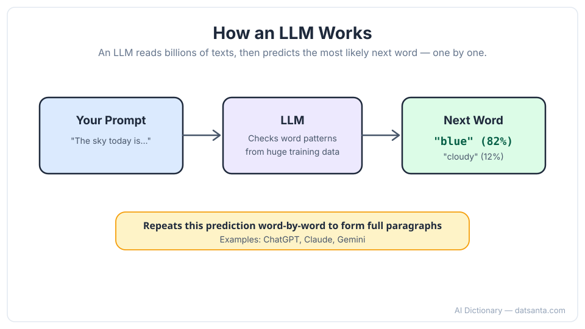

# LLM (Large Language Model)

An **LLM** is an AI system trained on massive amounts of text so it can understand and write human-like language. At its core, it works by predicting the most likely next word — one piece at a time — to form clear, useful answers.

## Everyday example

Think of the autocomplete on your phone keyboard, scaled up a million times. When you type *"The sky today is..."*, your phone guesses *"blue"* or *"cloudy"*.

An LLM has read billions of books, articles, and websites. Because it has seen so many patterns, it can predict entire emails, summaries, translations, and computer code — not just a single next word. ChatGPT, Claude, and Gemini are all powered by LLMs.

## Don't confuse with

- **Chatbot:** A chatbot is the app interface you type into (like the ChatGPT website); the LLM is the engine running underneath.
- **[AI agent](ai-agent.md):** An LLM only generates text replies, while an AI agent can plan steps and use external tools like your calendar or browser.

## Related terms

- [Generative AI](generative-ai.md)
- [Token](token.md)
- [Prompt](prompt.md)
- [Context window](context-window.md)
