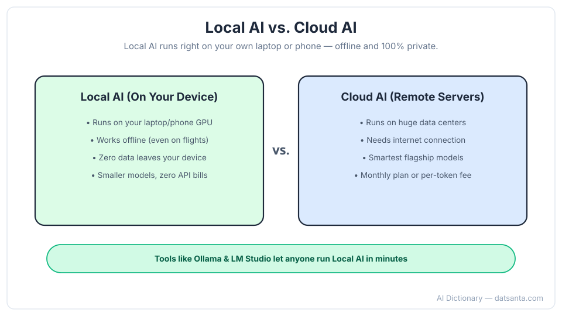

# Local AI

**Local AI** means running an AI model directly on your own laptop, desktop, or smartphone — with no internet connection required and zero data leaving your device.

## Everyday example

Think of editing a personal journal in a notes app on your laptop instead of typing it onto a public website. With tools like Ollama or LM Studio, you can download a compact, [quantized](quantization.md) model and chat with it even on an airplane with Wi-Fi turned off.

Local AI shines for total [data privacy](data-privacy.md) and zero monthly API bills, though smaller on-device models are usually less capable than giant [cloud AI](cloud-ai.md) flagships.

## Don't confuse with

- **[Cloud AI](cloud-ai.md):** Cloud AI runs on giant remote data centers and needs internet access; local AI runs right on your own CPU or GPU.
- **Desktop chat apps:** Installing the ChatGPT or Claude desktop app still sends your prompts over the internet to cloud servers — it is not local AI.

## Related terms

- [Cloud AI](cloud-ai.md)
- [Open-Source AI](open-source-ai.md)
- [Quantization](quantization.md)
- [Data Privacy](data-privacy.md)
