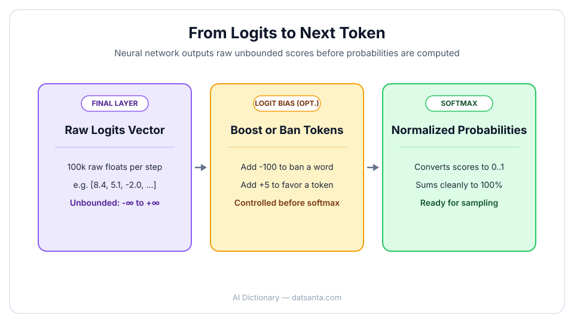

# Logits

**Logits** are the raw, unnormalized scores a neural network outputs for every token in its vocabulary right before converting them into probabilities.

## Everyday example

At a talent show, three judges write raw scores on paper—say `8.4` for Singer A, `5.1` for Singer B, and `-2.0` for Singer C. Those raw scores are logits: higher means stronger preference, and negative numbers are valid, but they are not percentages yet. Applying [softmax](softmax.md) turns those raw logits into clean probabilities that sum to `100%`. Developers also tweak logits directly (logit bias) to ban or boost specific tokens.

## Don't confuse with

- **[Softmax](softmax.md):** Logits are raw unbounded scores coming out of the model's final layer; softmax is the math function that converts logits into probabilities between 0 and 1.

## Related terms

- [Softmax](softmax.md)
- [Temperature](temperature.md)
- [Top-k Sampling](top-k-sampling.md)
