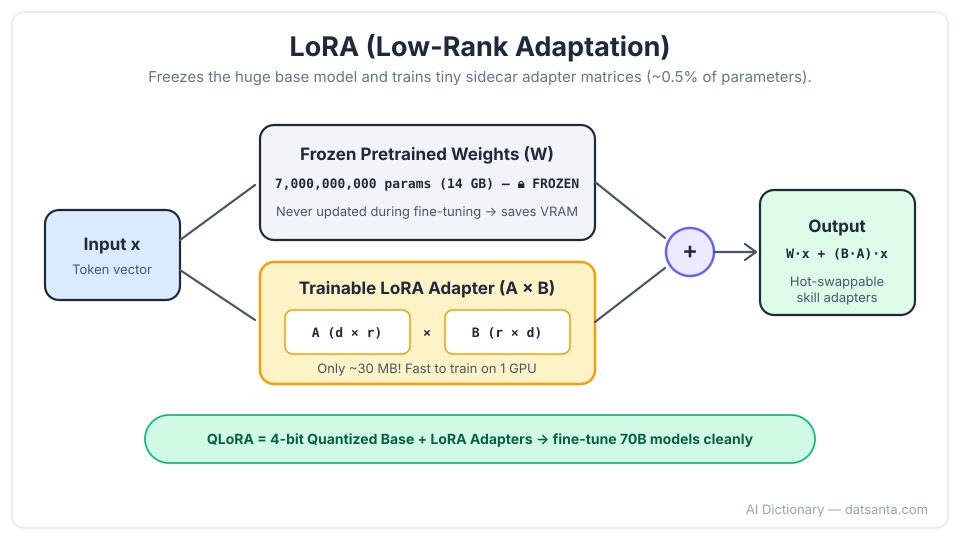

# LoRA (Low-Rank Adaptation)

**LoRA** is a parameter-efficient [fine-tuning](fine-tuning.md) method that freezes the huge pretrained model weights and trains only tiny adapter matrices alongside them, cutting GPU memory needs dramatically.

## Everyday example

Instead of rebuilding an entire 7-billion-parameter engine to add a specialized skill (requiring massive multi-GPU clusters), LoRA bolts on two tiny sidecar matrices (`A × B`) representing ~0.5% of the parameters.

The resulting adapter file is often just ~30 MB instead of 14 GB. You can even swap different LoRA adapters onto one frozen base model per customer or task at runtime.

## Don't confuse with

- **Full fine-tuning:** Full fine-tuning updates every single weight in the model, risking "catastrophic forgetting" and huge VRAM bills; LoRA keeps base knowledge intact.
- **QLoRA:** QLoRA combines a 4-bit [quantized](quantization.md) base model with LoRA adapters, letting you fine-tune massive models on a single consumer GPU.

## Related terms

- [Fine-tuning](fine-tuning.md)
- [Quantization](quantization.md)
- [RLHF](rlhf.md)
