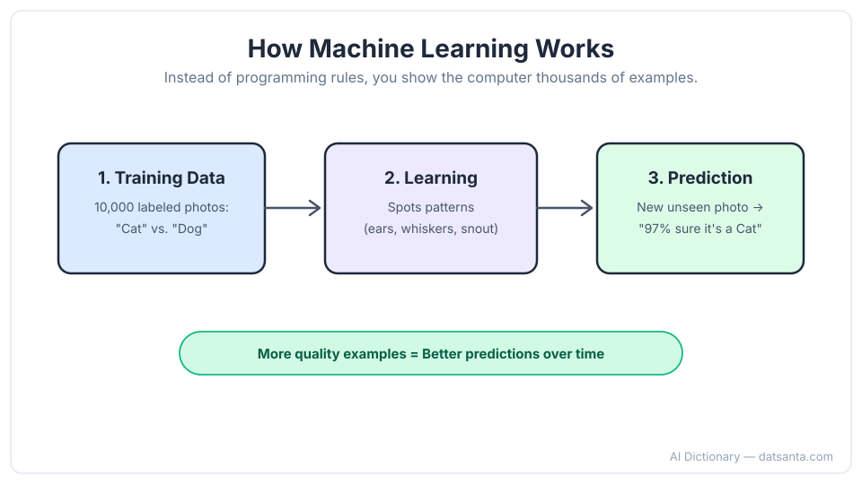

# Machine Learning

**Machine learning** is a way of teaching computers by showing them thousands of examples instead of writing step-by-step rules. The computer spots patterns on its own and uses them to make predictions on new data.

## Everyday example

Imagine teaching a child to tell cats from dogs. You do not write a rulebook saying *"if ears are pointy and nose is short, it is a cat."* You just point to hundreds of photos and say *"cat"* or *"dog"*. Soon, the child recognizes a new cat they have never seen before.

Machine learning works the same way: feed it 10,000 labeled photos, and it learns the visual patterns needed to sort new photos accurately.

## Don't confuse with

- **[AI](ai.md):** The broader goal of making machines act smart; machine learning is the main technique used to achieve it.
- **[Generative AI](generative-ai.md):** A newer branch of machine learning focused on creating brand-new text, images, or audio rather than just sorting or predicting.

## Related terms

- [AI](ai.md)
- [Generative AI](generative-ai.md)
- [Fine-tuning](fine-tuning.md)
