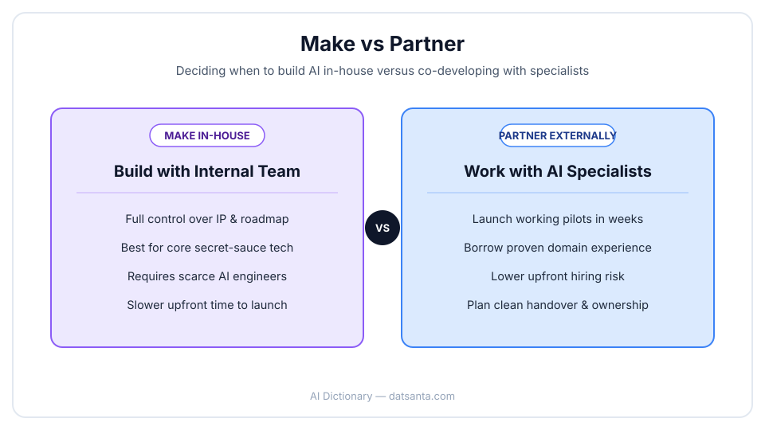

# Make vs. Partner

**Make vs. Partner** is deciding whether your company should build an AI capability purely with internal staff ("make") or co-develop it alongside an experienced external AI vendor, agency, or systems integrator ("partner").

## Everyday example

A logistics company wants an AI dispatch assistant. Hiring 4 senior AI engineers takes 6 months and high fixed payroll ("make"). Teaming up with a specialized AI studio to build the first version while training 1 internal developer ("partner") gets them live in 6 weeks.

Partnering trades slightly higher short-term consulting fees for speed and proven patterns — provided your team keeps ownership of the code and data.

## Don't confuse with

- **[Build vs. Buy](build-vs-buy.md):** "Buy" means subscribing to an off-the-shelf SaaS product as-is; "Partner" means building a *custom* solution together with an external specialist.
- **[Vendor lock-in](vendor-lock-in.md):** A good partner hands over clean source code, docs, and cloud access so your team is never trapped.

## Related terms

- [Build vs. Buy](build-vs-buy.md)
- [Vendor Lock-in](vendor-lock-in.md)
- [TCO](tco.md)
- [AI Strategy](ai-strategy.md)
