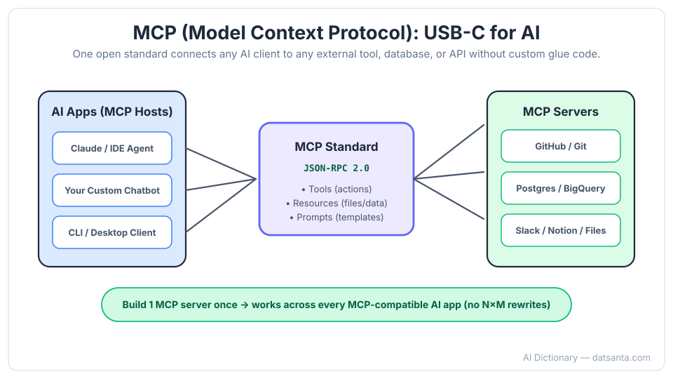

# MCP (Model Context Protocol)

**MCP** is an open standard protocol (like USB-C for AI apps) that defines a single way for any [LLM](llm.md) host or [agent](ai-agent.md) to connect to external tools, databases, and files.

## Everyday example

Before USB-C, every phone and laptop needed its own proprietary charger. Before MCP, connecting 5 AI clients to 10 internal tools (GitHub, Postgres, Slack, Notion) meant writing 50 custom integration wrappers.

With MCP, you build one lightweight **MCP Server** for Postgres using JSON-RPC, exposing standardized **Tools**, **Resources**, and **Prompts**. Every MCP-compatible IDE, CLI, or agent can plug in immediately.

## Don't confuse with

- **[Function calling](function-calling.md):** Function calling is how an LLM requests a tool during a single API call; MCP is the client-server transport layer that lets apps discover and run external tools uniformly.
- **REST API:** REST exposes raw endpoints for developers; MCP includes machine-readable schemas and descriptions designed specifically for LLM discovery.

## Related terms

- [Function Calling](function-calling.md)
- [AI Agent](ai-agent.md)
- [Orchestration](orchestration.md)
- [Sandbox](sandbox.md)
