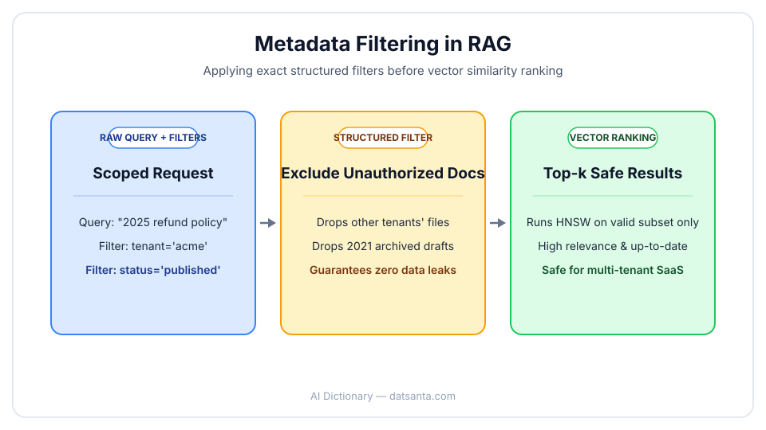

# Metadata Filtering

**Metadata filtering** narrows down a vector database search using structured fields—such as `tenant_id`, `date`, `department`, or `doc_type`—before or during similarity matching.

## Everyday example

Searching an entire company drive for `"refund policy"` might pull up an expired 2021 draft or another client's private contract. With metadata filtering (`company = "acme" AND year >= 2025 AND status = "published"`), the vector index only searches authorized, current records. It is essential for multi-tenant SaaS apps so one customer's [RAG](rag.md) query can never leak another customer's documents.

## Don't confuse with

- **[Reranking](reranking.md):** Reranking re-orders top retrieved chunks by reading their full text relevance; metadata filtering strictly includes or excludes chunks using exact structured attributes.

## Related terms

- [Vector Database](vector-database.md)
- [HNSW](hnsw.md)
- [RAG](rag.md)
