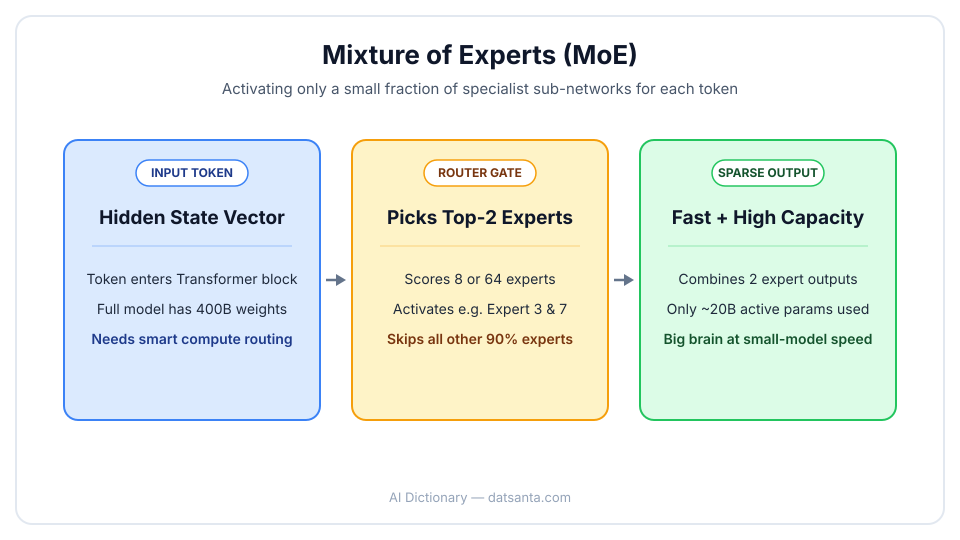

# Mixture of Experts (MoE)

**Mixture of Experts (MoE)** is an architecture that splits a huge neural network into many smaller specialist sub-networks ("experts") and uses a lightweight router to activate only a few experts per token.

## Everyday example

A large hospital employs 64 specialist doctors, yet when you walk in with a sprained ankle, only the triage nurse and 2 orthopedic specialists see you—not all 64 doctors at once. Similarly, an MoE model might have 400 billion total parameters in memory, but only activate 20 billion parameters per token. You get large-model knowledge at small-model inference speed.

## Don't confuse with

- **[Multi-Agent System](multi-agent-system.md):** Multi-agent systems coordinate separate LLM calls at the application layer; MoE routes tokens internally across feed-forward layers inside one single model.

## Related terms

- [Transformer](transformer.md)
- [Inference](inference.md)
- [VRAM](vram.md)
