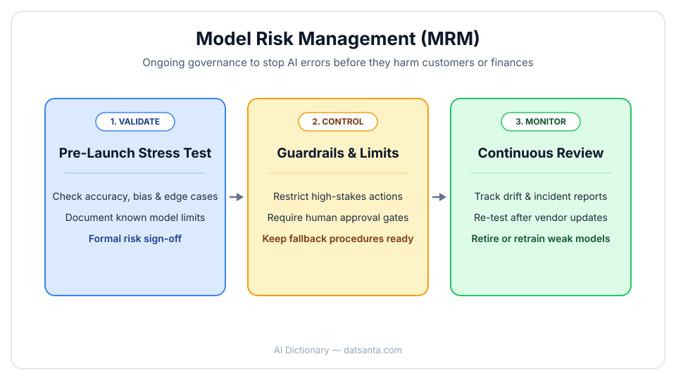

# Model Risk Management

**Model risk management (MRM)** is the ongoing discipline of testing, approving, and monitoring AI models so mistakes, bias, or sudden behavior changes do not cause financial loss, legal trouble, or harm to customers.

## Everyday example

Airlines do not inspect a plane once when they buy it and never check it again. They run pre-flight checklists, log every warning light, and ground an aircraft if an engine behaves oddly. Model risk management applies that mindset to business AI: before an AI tool approves refunds or scores job applicants, a risk team checks its failure modes and monitors it after launch.

## Don't confuse with

- **[AI Pilot](ai-pilot.md):** A pilot tests whether a tool creates business value over a few weeks; model risk management continuously guards against operational, legal, and reputational harm.

## Related terms

- [Post-Deployment Monitoring](post-deployment-monitoring.md)
- [Audit Trail](audit-trail.md)
- [Compliance](compliance.md)
