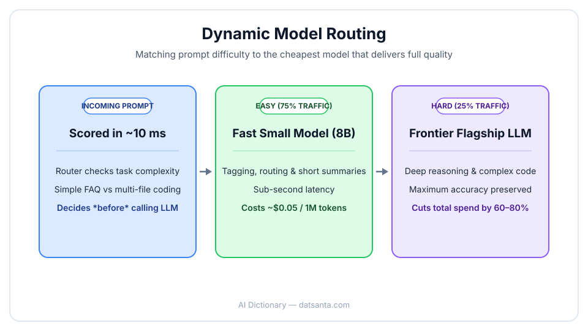

# Model Routing

**Model routing** dynamically inspects each incoming request's complexity, length, or sensitivity and sends easy tasks to a fast, cheap small model while reserving expensive frontier models for hard reasoning.

## Everyday example

A customer support desk does not route `"Where is my tracking number?"` to a senior legal director. A lightweight router classifier checks incoming requests in 10 ms: simple intent classification or summarization goes to a tiny 8B model for $0.05 per million tokens, while multi-file debugging or contract review routes to a frontier model—cutting total inference spend by 60–80% with no quality drop.

## Don't confuse with

- **[Fallback Chain](fallback-chain.md):** Fallback chains switch models only when the primary provider *errors or times out*; model routing intentionally chooses the best price-performance model *before* the first call.

## Related terms

- [Service Tiering](service-tiering.md)
- [AI Gateway](ai-gateway.md)
- [Cost per Task](cost-per-task.md)
