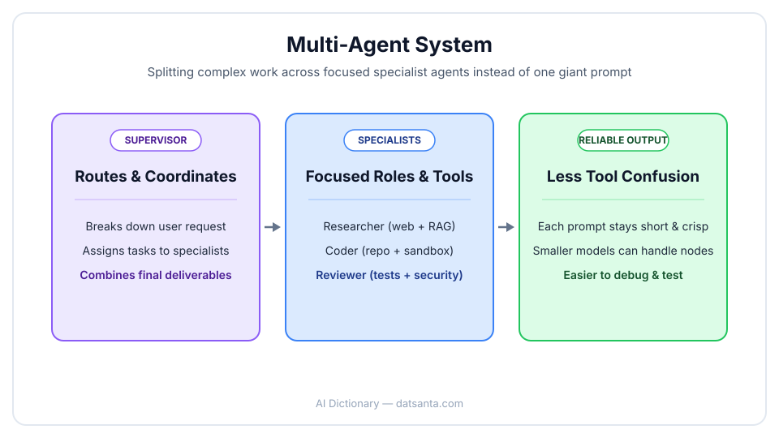

# Multi-Agent System

A **multi-agent system** splits a complex workflow across multiple specialized AI agents—each with its own system prompt, model, and narrow set of tools—coordinating through a router, supervisor, or shared state.

## Everyday example

A software product is rarely built by one person doing design, backend code, security audits, and copywriting alone—and stuffing 40 tools into a single LLM prompt makes it confused. Instead, a triage supervisor routes research to a Researcher agent, code changes to a Coder agent, and final checks to a Reviewer agent, keeping each prompt focused and reliable.

## Don't confuse with

- **[Mixture of Experts (MoE)](mixture-of-experts.md):** MoE is an internal neural-network layer inside a *single* model; a multi-agent system orchestrates *multiple separate LLM calls* at the application level.

## Related terms

- [Orchestration](orchestration.md)
- [Handoff](handoff.md)
- [A2A Protocol](a2a-protocol.md)
