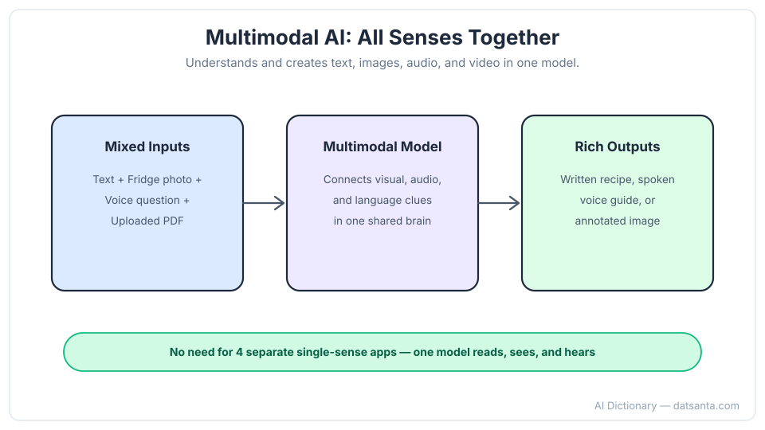

# Multimodal AI

**Multimodal AI** is an AI model that can understand and generate more than one type of media — combining text, images, audio, video, and documents together in a single conversation.

## Everyday example

Earlier AI tools were single-sense: one tool only read text, another only recognized photos, and a third only transcribed voice.

With multimodal AI, you can snap a photo of a messy fridge, ask out loud *"What quick dinner can I cook with these?"*, and get a spoken recipe back. It connects what it sees, hears, and reads just like a person does.

## Don't confuse with

- **[LLM](llm.md) (text-only):** Classic LLMs only processed written text; modern flagship models are multimodal, accepting screenshots, PDFs, voice, and video alongside text.
- **[Text-to-image](text-to-image.md):** Text-to-image only turns words into pictures; multimodal AI works fluidly across multiple input and output types.

## Related terms

- [Foundation Model](foundation-model.md)
- [Computer Vision](computer-vision.md)
- [Text-to-Image](text-to-image.md)
- [Speech-to-Text](speech-to-text.md)
