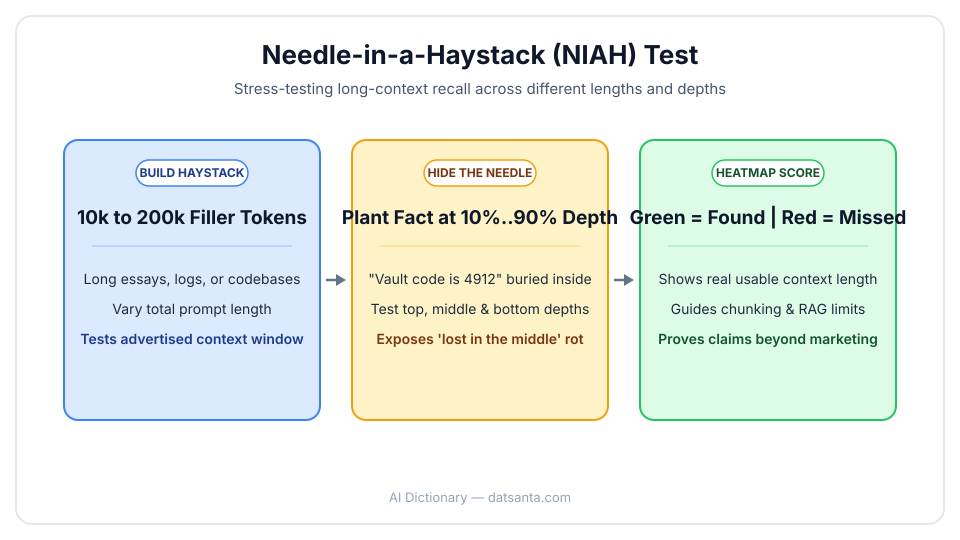

# Needle-in-a-Haystack Test

A **Needle-in-a-Haystack (NIAH) test** evaluates long-context models by hiding one specific random fact ("the needle") at varying depths inside a massive wall of filler text ("the haystack") and checking if the model can retrieve it accurately.

## Everyday example

If an automaker claims its truck carries 10 tons, you test it with real cargo instead of trusting the brochure. Similarly, if an LLM advertises a `200,000`-token [context window](context-window.md), developers hide `"The secret vault code is 4912"` at 10%, 50%, and 90% depth inside 150,000 tokens of essays to reveal where [context rot](context-rot.md) starts hurting recall.

## Don't confuse with

- **[Benchmark](benchmark.md):** General benchmarks test coding, math, or trivia IQ across short prompts; NIAH specifically stress-tests long-context recall across different prompt lengths and positions.

## Related terms

- [Context Rot](context-rot.md)
- [Context Window](context-window.md)
- [Evals (Evaluations)](evals.md)
