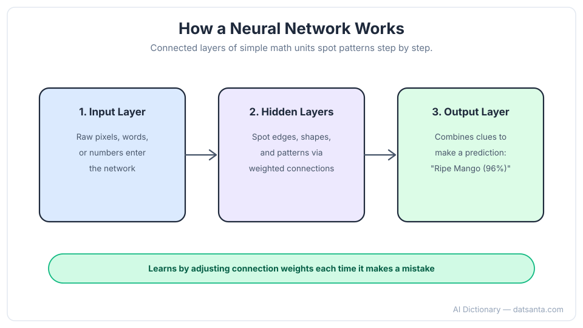

# Neural Network

A **neural network** is a computer system loosely inspired by the human brain, made of connected layers of simple math units that work together to recognize patterns in data.

## Everyday example

Imagine a team of people sorting fruit on a conveyor belt. The first group checks only color, the second checks shape and size, and the final person combines those clues to decide: *"That's a ripe mango."*

A neural network works the same way. Raw pixels enter the first layer, middle layers spot edges and shapes, and the final layer outputs an answer — adjusting connection strengths every time it makes a mistake.

## Don't confuse with

- **A real human brain:** Neural networks do not feel, think, or have consciousness; they are just layers of weighted multiplication and addition.
- **[Deep learning](deep-learning.md):** Deep learning is simply a neural network with *many* stacked hidden layers instead of just one or two.

## Related terms

- [Deep Learning](deep-learning.md)
- [Machine Learning](machine-learning.md)
- [Parameters](parameters.md)
- [Training Data](training-data.md)
