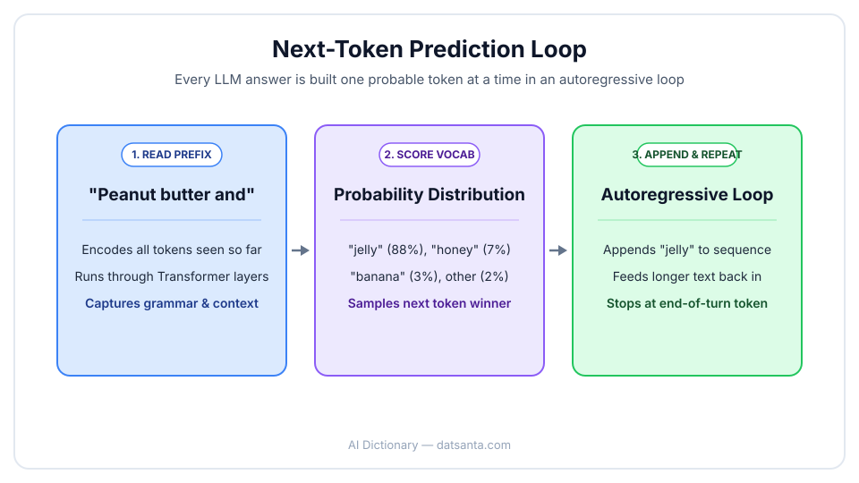

# Next-Token Prediction

**Next-token prediction** is the core training objective and runtime mechanism of every modern LLM: given all tokens seen so far, compute a probability distribution over the vocabulary and pick the single most plausible next token—repeating until done.

## Everyday example

When a friend starts saying `"Peanut butter and ..."`, your brain immediately predicts `"jelly"` with high confidence before they finish. Scaling that simple game across trillions of words of code, books, and math forces the neural network to learn grammar, logic, and programming patterns just to predict the next token accurately. It also explains why models cannot "take back" a wrong word already emitted without generating a correction afterward.

## Don't confuse with

- **[Reasoning Model](reasoning-model.md):** Reasoning models still use next-token prediction under the hood—they simply spend extra hidden tokens thinking through steps before emitting the final visible answer.

## Related terms

- [Token](token.md)
- [Logits](logits.md)
- [LLM](llm.md)
