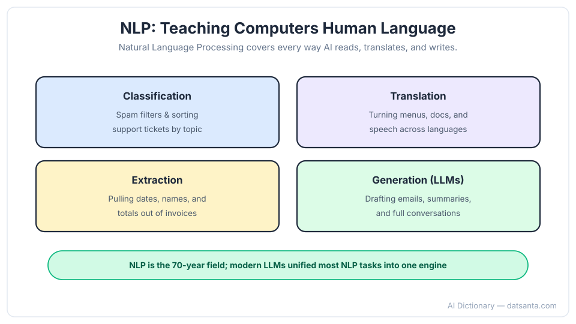

# NLP (Natural Language Processing)

**NLP** is the branch of AI focused on helping computers read, understand, translate, and write everyday human language — instead of requiring rigid computer code.

## Everyday example

Every time Gmail catches a spam email, Google Translate turns a menu from Thai to English, or your phone predicts the next word while texting, you are using NLP.

For decades, NLP meant separate small tools for grammar, translation, and sentiment analysis. Today, [LLMs](llm.md) powered by [Transformers](transformer.md) handle almost all classic NLP tasks inside one unified model.

## Don't confuse with

- **[LLM](llm.md):** NLP is the entire 70-year field of language AI; LLMs are the modern breakout technology inside that field.
- **Programming languages:** Python or JavaScript are formal languages designed for machines; "natural language" means messy everyday speech like English or Vietnamese.

## Related terms

- [LLM](llm.md)
- [Transformer](transformer.md)
- [Speech-to-Text](speech-to-text.md)
- [Generative AI](generative-ai.md)
