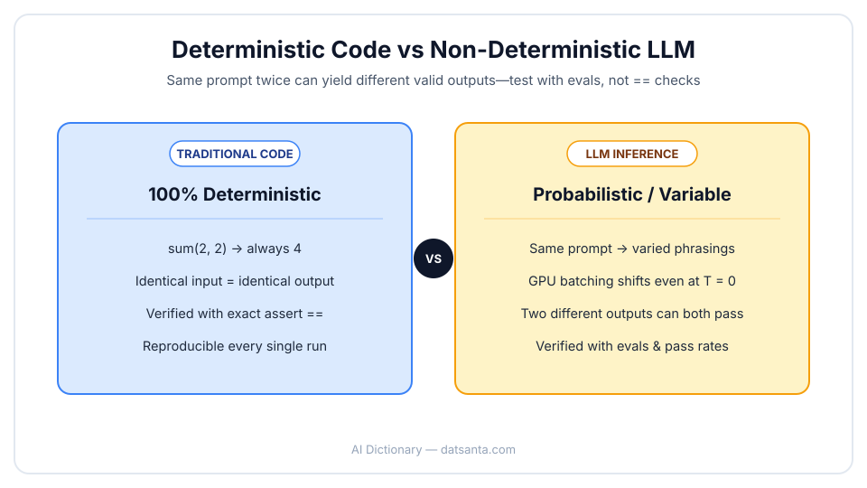

# Non-Determinism

**Non-determinism** means giving an LLM the exact same prompt twice can produce two different wordings, code structures, or tool-call sequences—unlike traditional software functions that always return the identical output for identical input.

## Everyday example

A calculator is deterministic: `2 + 2` returns `4` every single time for a hundred years. Asking a human copywriter to `"summarize this report in two sentences"` on Monday and again on Tuesday gives two valid—yet differently phrased—summaries. Even at [temperature](temperature.md) `0`, GPU floating-point batching causes minor drift, which is why AI apps rely on [evals](evals.md) and pass rates instead of exact string equality tests.

## Don't confuse with

- **[Hallucination](hallucination.md):** Non-determinism means outputs naturally vary between runs (even when both are completely correct); hallucination means the output is factually wrong.

## Related terms

- [Temperature](temperature.md)
- [Evals (Evaluations)](evals.md)
- [Golden Dataset](golden-dataset.md)
