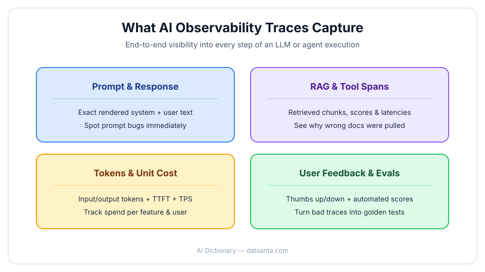

# AI Observability (Tracing)

**AI observability** captures end-to-end traces of every LLM request—prompts, retrieved [RAG](rag.md) chunks, tool calls, token counts, latency, and errors—so developers can debug weird answers and monitor production health.

## Everyday example

Standard web logs only tell you `"POST /chat returned 200 OK in 3.2s"`, which is useless when a user complains `"the bot gave me the wrong price"`. Observability tracing records the whole waterfall: query rewrite took 200 ms, vector search pulled 5 outdated chunks, and the LLM took 2.8s—letting engineers pinpoint the exact failing step in seconds.

## Don't confuse with

- **[Audit Trail](audit-trail.md):** Audit trails are immutable compliance records proving *who approved what* for regulators; observability traces are developer telemetry for debugging latency, retrieval quality, and token spend.

## Related terms

- [AI Gateway](ai-gateway.md)
- [Post-Deployment Monitoring](post-deployment-monitoring.md)
- [Token Counting](token-counting.md)
