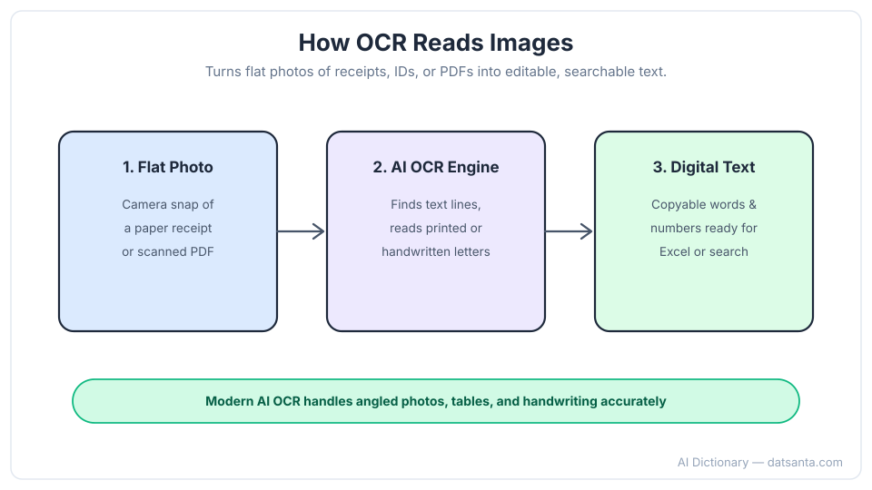

# OCR (Optical Character Recognition)

**OCR** is technology that reads text inside images, scanned PDFs, or camera photos — turning flat pictures of words into editable, searchable digital text.

## Everyday example

When you point your banking app camera at a paper bill, scan an ID card at airport check-in, or copy text straight out of a screenshot on your phone, OCR is doing the reading.

Classic OCR struggled with blurry photos, crooked receipts, or handwriting. Modern AI-powered OCR combines [computer vision](computer-vision.md) and language understanding to extract neat tables and handwritten notes accurately.

## Don't confuse with

- **Taking a screenshot or PDF scan:** A normal scan saves a *picture* of the page where you still cannot highlight or search words; OCR converts those pixel shapes into real text characters.
- **[Computer vision](computer-vision.md):** Computer vision recognizes *everything* in an image (cars, faces, dogs); OCR is the specialized branch focused strictly on reading printed or handwritten characters.

## Related terms

- [Computer Vision](computer-vision.md)
- [Multimodal AI](multimodal-ai.md)
- [RAG](rag.md)
