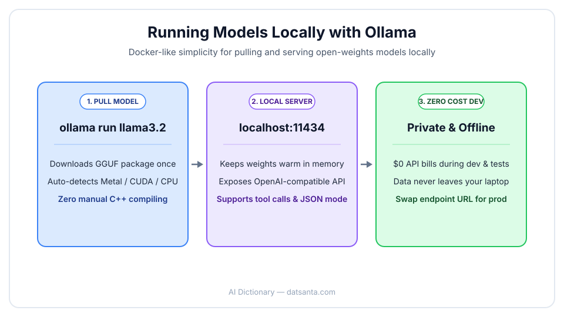

# Ollama (Local Model Runner)

**Ollama** is a developer-friendly local model runner and CLI that downloads open-weights models (packaged in [GGUF](gguf.md)), manages GPU/CPU memory automatically, and exposes a local OpenAI-compatible HTTP API on your machine.

## Everyday example

Running open-weights models used to mean compiling C++ flags or wrangling Python CUDA environments for hours. With Ollama, typing `ollama run llama3.2` works just like `docker run`: it pulls the quantized weights, starts a background server on `localhost:11434`, and lets your local code test prompts and [structured outputs](structured-outputs.md) offline for $0 in API fees.

## Don't confuse with

- **[vLLM](vllm.md):** Ollama is built for easy single-developer local execution and prototyping on laptops; vLLM is built for high-concurrency multi-user production clusters.

## Related terms

- [GGUF Format](gguf.md)
- [vLLM](vllm.md)
- [Quantization](quantization.md)
