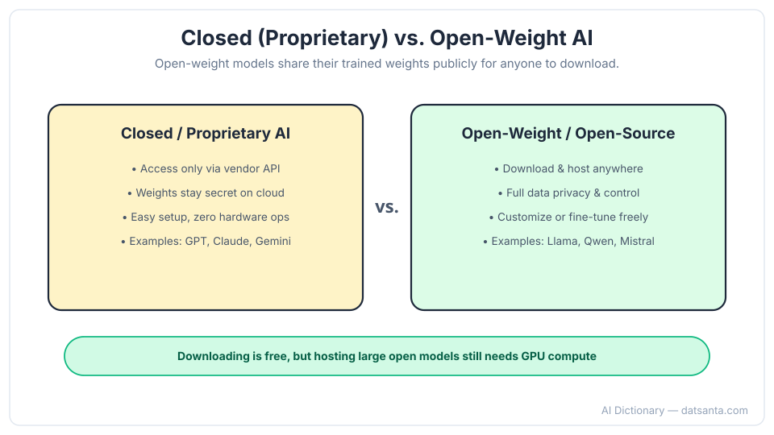

# Open-Source AI (Open-Weight)

**Open-source AI** (more accurately called **open-weight**) refers to AI models whose trained weights are released publicly so anyone can download, customize, or run them on their own hardware instead of relying solely on one vendor's API.

## Everyday example

Compare eating at a restaurant with a secret sauce (closed models like GPT or Claude via API) versus getting the finished spice blend to cook freely in your own kitchen (open-weight models like Llama, Mistral, Qwen, or DeepSeek).

Open-weight models give companies full control over [data privacy](data-privacy.md), avoid [vendor lock-in](vendor-lock-in.md), and allow running [local AI](local-ai.md) offline.

## Don't confuse with

- **Free to run:** Downloading the model file is free, yet running a massive 70B model still requires electricity and expensive GPUs (or paying a hosting provider).
- **100% open training data:** Many "open-source" AI releases share the model weights and code, yet keep their original [training data](training-data.md) private — which is why experts often say *open-weight*.

## Related terms

- [Local AI](local-ai.md)
- [Cloud AI](cloud-ai.md)
- [Foundation Model](foundation-model.md)
- [Vendor Lock-in](vendor-lock-in.md)
