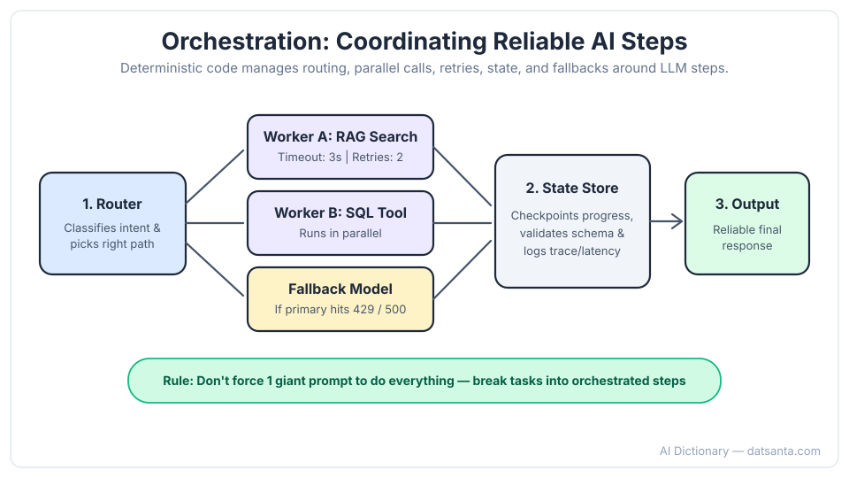

# Orchestration

**Orchestration** is the application code that coordinates multiple [LLM](llm.md) calls, routing logic, parallel tool runs, retries, state checkpoints, and fallback models into one reliable pipeline.

## Everyday example

A single prompt trying to classify intent, search docs, format JSON, and send an email is like asking one musician to play five instruments simultaneously.

Orchestration acts as the conductor: a lightweight router picks the right path, workers run [RAG](rag.md) and SQL tools in parallel with 3-second timeouts, failed calls fall back to a backup model, and state checkpoints let long jobs resume cleanly after crashes.

## Don't confuse with

- **Prompt chaining:** Simply piping output A into prompt B is basic chaining; orchestration handles branching, parallelism, error recovery, observability, and [rate limiting](rate-limiting.md).
- **Autonomous [AI agent](ai-agent.md):** Agents let the LLM choose steps dynamically; orchestration lets deterministic code control critical paths reliably.

## Related terms

- [AI Workflow](ai-workflow.md)
- [AI Agent](ai-agent.md)
- [Rate Limiting](rate-limiting.md)
- [MCP](mcp.md)
