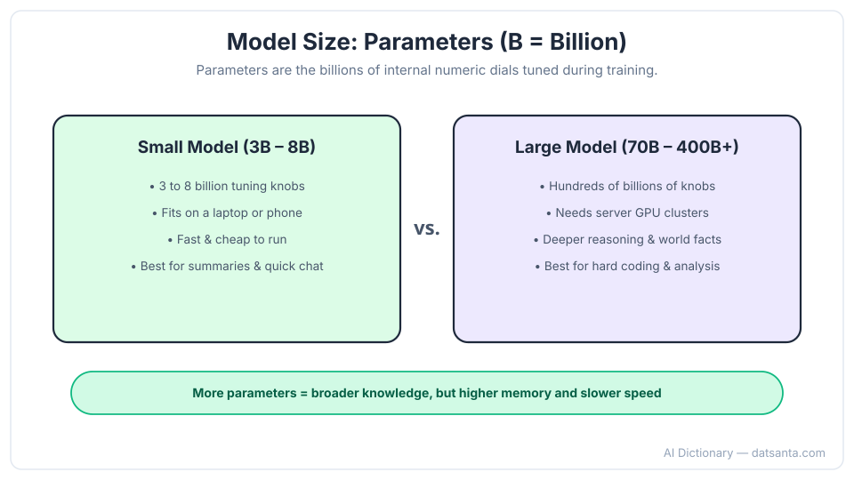

# Parameters

**Parameters** (also called weights) are the millions or billions of tiny internal numbers inside an AI model that get tuned during training so the model learns how to answer accurately.

## Everyday example

Imagine a giant sound mixing board in a recording studio covered in sliders. Moving each slider slightly changes how clear the music sounds.

When you see names like **"Llama 8B"** or **"70B"**, the `B` stands for **billion parameters** — meaning 8 billion or 70 billion tiny numeric dials adjusted during training. More parameters usually allow deeper knowledge, yet require bigger, pricier GPUs to run.

## Don't confuse with

- **[Tokens](token.md):** Tokens are the pieces of text going *into* or *out of* the model; parameters are the fixed internal numbers stored *inside* the model file.
- **API settings (like [temperature](temperature.md)):** Users call API options "parameters" too, though in model names (`7B`, `70B`) parameters always mean the learned internal weights.

## Related terms

- [Neural Network](neural-network.md)
- [Quantization](quantization.md)
- [LLM](llm.md)
- [LoRA](lora.md)
