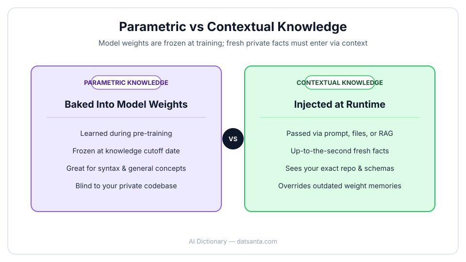

# Parametric Knowledge

**Parametric knowledge** is all the facts, coding syntax, and reasoning patterns baked directly into a model's neural network weights during training—frozen at its [knowledge cutoff](knowledge-cutoff.md).

## Everyday example

Think of everything a doctor remembers from medical school without opening a single book: that is parametric knowledge. Looking up a patient's fresh lab results in a folder on the desk is *contextual knowledge* (supplied via prompt or [RAG](rag.md)). Relying purely on parametric knowledge fails for private codebases or newly released libraries, which is why coding [harnesses](harness.md) read live files and docs into context.

## Don't confuse with

- **[RAG](rag.md):** Parametric knowledge lives inside the model's frozen weights; RAG injects fresh, external *contextual knowledge* into the prompt at runtime.

## Related terms

- [Knowledge Cutoff](knowledge-cutoff.md)
- [Parameters](parameters.md)
- [RAG](rag.md)
