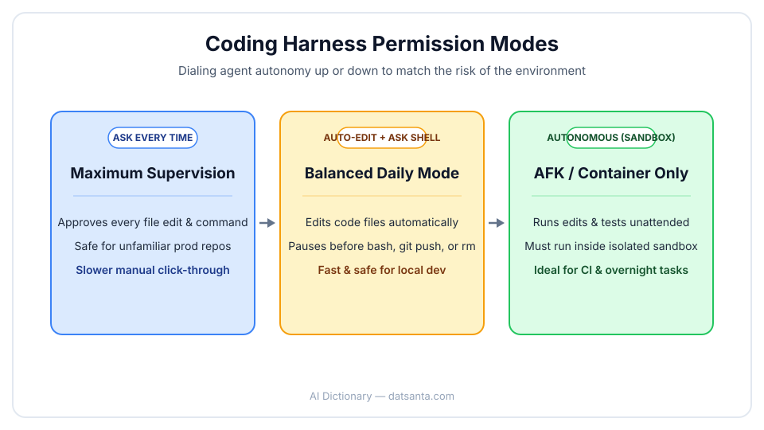

# Permission Mode

A **permission mode** is a safety setting in an AI coding [harness](harness.md) that controls which actions the agent can run automatically versus which risky operations (like shell commands or deleting files) require explicit human approval.

## Everyday example

Think of giving a teen driver progressive privileges: first they drive only with a parent in the passenger seat (`Ask Every Time`), then solo on familiar neighborhood roads (`Auto-Edit Files, Ask for Shell`), and finally full highway autonomy inside a safe vehicle (`Bypass / YOLO` inside an isolated [sandbox](sandbox.md)). Matching permission mode to blast radius keeps coding fast without risking `rm -rf` disasters.

## Don't confuse with

- **[Sandbox](sandbox.md):** A sandbox is the technical OS/container wall limiting *what the machine can physically touch*; permission mode is the harness UI policy deciding *when to pause and ask the user*.

## Related terms

- [Harness](harness.md)
- [Sandbox](sandbox.md)
- [AFK Agent](afk-agent.md)
