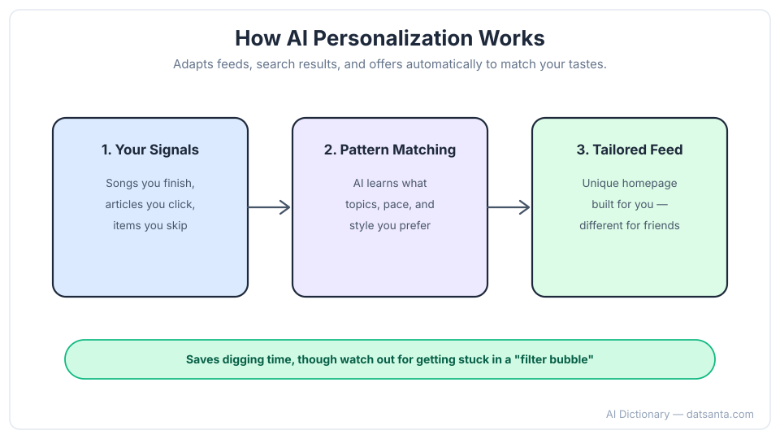

# Personalization

**Personalization** is using AI to tailor content, search results, product offers, or learning pace automatically to match each individual user's interests and behavior.

## Everyday example

Two friends open Spotify or Netflix at the exact same moment and see completely different homepages. One sees acoustic guitar playlists and documentaries; the other sees K-pop hits and sci-fi series.

By spotting patterns in what you click, skip, or finish watching, AI adjusts what appears next — saving you time digging through millions of options, though sometimes trapping you in a "filter bubble."

## Don't confuse with

- **Manual customization:** Picking Dark Mode or choosing your favorite news categories yourself is customization; personalization adapts automatically behind the scenes.
- **[Recommendation system](recommendation-system.md):** A recommendation system is the specific engine suggesting items ("You might also like..."); personalization is the broader goal of tailoring the whole experience.

## Related terms

- [Recommendation System](recommendation-system.md)
- [Machine Learning](machine-learning.md)
- [Data Privacy](data-privacy.md)
