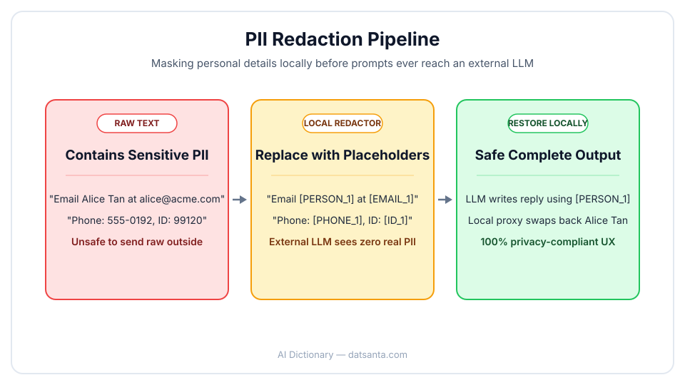

# PII Redaction

**PII redaction** is the automated preprocessing step that scans outgoing prompts and documents to mask or replace sensitive personal details ([PII](pii.md))—like emails, phone numbers, and IDs—with safe placeholders before calling an external LLM.

## Everyday example

Before sending a medical case file to an outside consultant, a clinic blacks out the patient's name and Social Security number and writes `"Patient A"`. In code, a PII redaction pipeline turns `"Call Alice Tan at 555-0192"` into `"Call [PERSON_1] at [PHONE_1]"`, lets the LLM draft the response using placeholders, and swaps the real values back locally afterward.

## Don't confuse with

- **[Zero Data Retention](zero-data-retention.md):** Zero data retention is a *contractual promise* that the vendor deletes prompts after answering; PII redaction ensures sensitive personal data *never leaves your server* in the first place.

## Related terms

- [PII](pii.md)
- [Zero Data Retention](zero-data-retention.md)
- [AI Gateway](ai-gateway.md)
