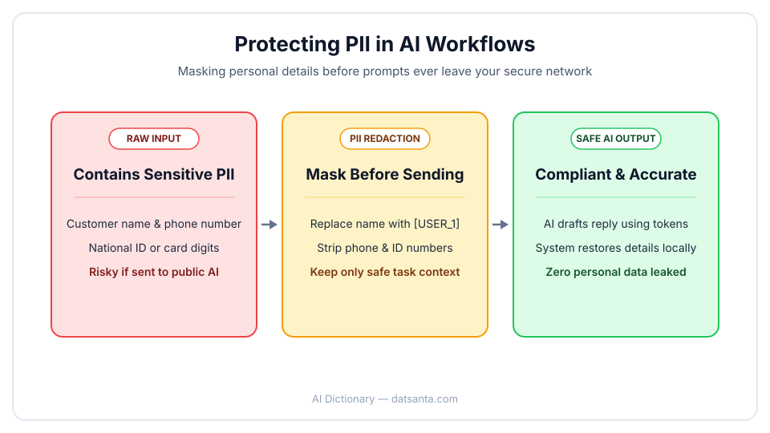

# PII (Personally Identifiable Information)

**PII (Personally Identifiable Information)** is any detail that can identify a specific person—such as their full name, phone number, email, national ID, home address, or bank account.

## Everyday example

When an employee pastes a customer complaint email into a public AI tool to draft a polite reply, that message might include the customer's phone number, order address, and credit card digits. Even if the AI writes a great email, pasting raw PII into unapproved tools can violate privacy laws and leak customer trust. Safe enterprise AI setups automatically mask or strip PII before sending text to external models.

## Don't confuse with

- **[Data Governance](data-governance.md):** PII is a specific category of sensitive personal data; data governance is the broader rulebook for managing all company data safely.

## Related terms

- [Zero Data Retention](zero-data-retention.md)
- [Compliance](compliance.md)
- [Guardrails](guardrails.md)
