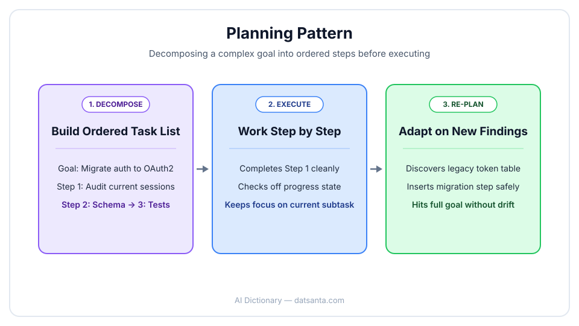

# Planning Pattern

The **planning pattern** instructs an agent to break a complex goal into an ordered list of smaller subtasks upfront before executing them one by one, updating the plan if new obstacles appear.

## Everyday example

Before remodeling a bathroom, a contractor writes a sequenced checklist: shut off water, demo tiles, rough-in plumbing, lay tile, install vanity. Jumping straight into hammering without a plan causes expensive rework. When an AI agent faces a multi-step research or coding task, generating an explicit step-by-step plan first prevents it from forgetting earlier requirements halfway through.

## Don't confuse with

- **[Reflection Pattern](reflection-pattern.md):** Planning organizes *what steps to take next* before acting; reflection evaluates and fixes *output already produced*.

## Related terms

- [Reflection Pattern](reflection-pattern.md)
- [ReAct Pattern](react-pattern.md)
- [Orchestration](orchestration.md)
