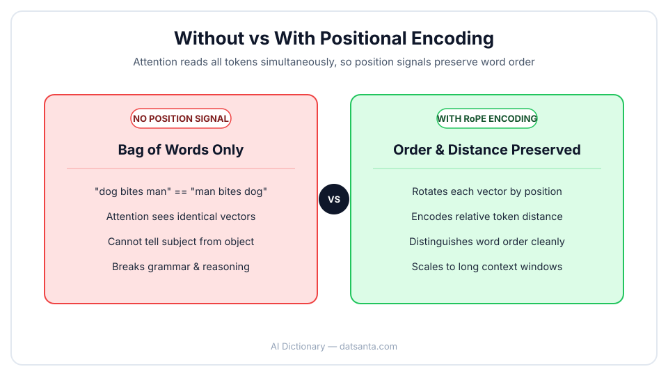

# Positional Encoding

**Positional encoding** injects order information into token embeddings so a [Transformer](transformer.md) knows whether `"dog bites man"` or `"man bites dog"` was written, since attention reads all tokens in parallel.

## Everyday example

Imagine dumping 20 Scrabble tiles onto a table at the same time—without numbering them `1, 2, 3...`, anyone reading them sees a bag of words with no word order. Modern LLMs use RoPE (Rotary Positional Embedding), which rotates each token's vector by an angle proportional to its position. That lets attention naturally measure the relative distance between any two words, even across long documents.

## Don't confuse with

- **[Embeddings](embeddings.md):** Token embeddings encode *what* a word means; positional encoding encodes *where* that token sits in the sequence.

## Related terms

- [Transformer](transformer.md)
- [Attention Mechanism](attention-mechanism.md)
- [Context Window](context-window.md)
