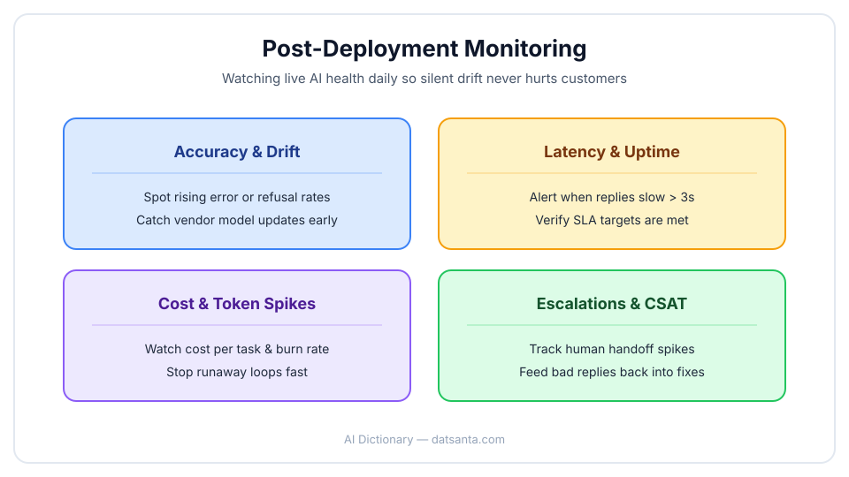

# Post-Deployment Monitoring

**Post-deployment monitoring** is continuously watching an AI system *after* it goes live to catch accuracy drops, unexpected costs, latency spikes, or safety failures before customers notice.

## Everyday example

Launching a new delivery app does not mean engineers delete their dashboards on day two. Even if an AI support bot passed every test in January, a subtle vendor model update or a new seasonal product catalog in April can suddenly make answers wrong or twice as slow. Ongoing monitoring tracks error rates, escalations, token spend, and user feedback every single day.

## Don't confuse with

- **[AI Pilot](ai-pilot.md):** A pilot is a temporary pre-launch trial to decide whether to roll out; post-deployment monitoring runs permanently once the system is live in production.

## Related terms

- [Model Risk Management](model-risk-management.md)
- [Audit Trail](audit-trail.md)
- [SLA](sla.md)
