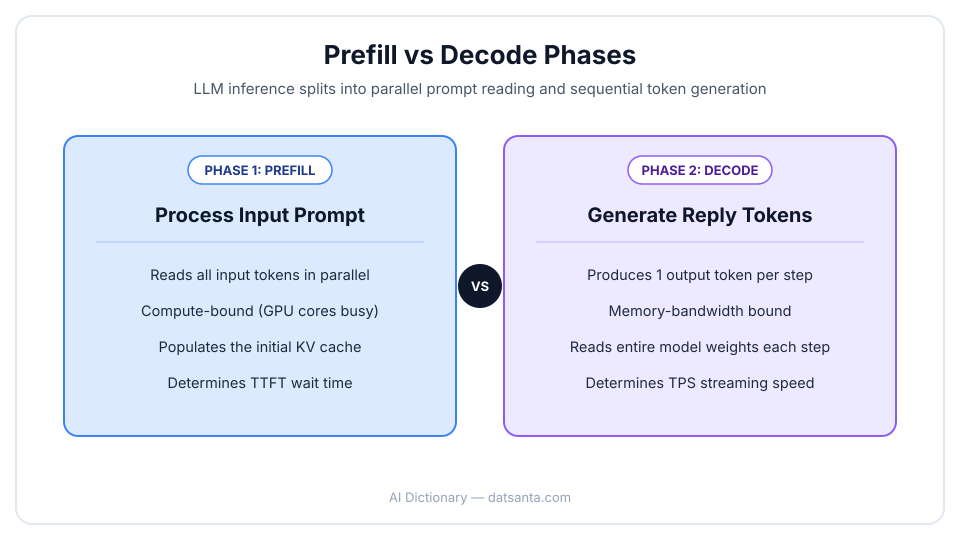

# Prefill and Decode

**Prefill** and **decode** are the two distinct phases of LLM inference: prefill processes your entire input prompt in parallel, while decode generates the answer one token at a time.

## Everyday example

Cooking a big dinner has two stages: prep and plating. During prep (prefill), ten kitchen helpers chop all the vegetables at once—heavy compute, finished in one burst. During plating (decode), one chef places each dish on the pass sequentially—slower, memory-bound, one piece after another. That is why a huge prompt delays your *first* word (prefill), while a long reply takes time to finish streaming (decode).

## Don't confuse with

- **[TTFT (Time to First Token)](ttft.md):** Prefill and decode are the two underlying compute phases; TTFT measures how long the prefill phase takes before the first token appears.

## Related terms

- [TTFT](ttft.md)
- [TPS (Tokens per Second)](tps.md)
- [KV Cache](kv-cache.md)
