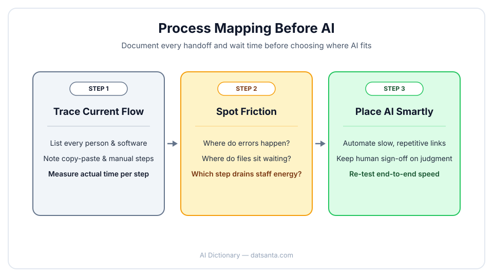

# Process Mapping

**Process mapping** is writing down every step of how a job currently gets done—who does what, which tools are touched, and where delays happen—before deciding where AI should help.

## Everyday example

Before renovating a busy restaurant kitchen, you trace how orders move from the waiter to the stove to the pass. Only then do you notice that cooks waste half their time walking across the room for sauces. In business, mapping a workflow shows that AI should probably automate copying invoice numbers into the ERP, not rewrite the polite email at the very end.

## Don't confuse with

- **[Use Case Prioritization](use-case-prioritization.md):** Process mapping visualizes how work flows today; prioritization ranks which mapped steps are most worth automating first.

## Related terms

- [Bottleneck Analysis](bottleneck-analysis.md)
- [AI Readiness](ai-readiness.md)
- [AI Pilot](ai-pilot.md)
