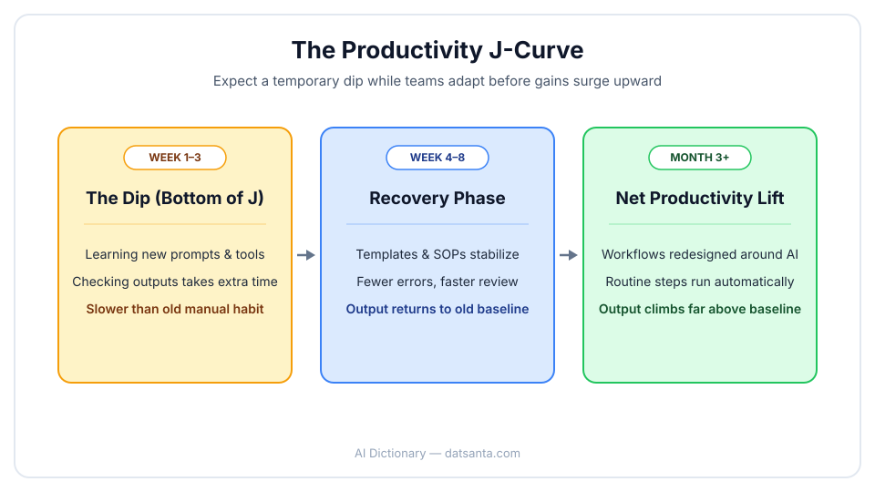

# Productivity J-Curve

The **productivity J-curve** is the common dip in speed or output right after a team introduces AI, before habits settle, workflows adapt, and real productivity gains climb above the old baseline.

## Everyday example

When an accounting team switches from paper ledgers to new software, the first three weeks are slower than doing it by hand because everyone is learning shortcuts, fixing setup mistakes, and double-checking numbers. By month three, they finish closeout twice as fast. Leaders who expect instant magic in week one often cancel good AI tools right at the bottom of the J-curve.

## Don't confuse with

- **[AI Pilot](ai-pilot.md):** A pilot is a controlled test of an AI tool; the J-curve describes the natural dip-then-rise performance pattern during rollout.

## Related terms

- [Change Management](change-management.md)
- [AI Adoption](ai-adoption.md)
- [AI KPI](ai-kpi.md)
